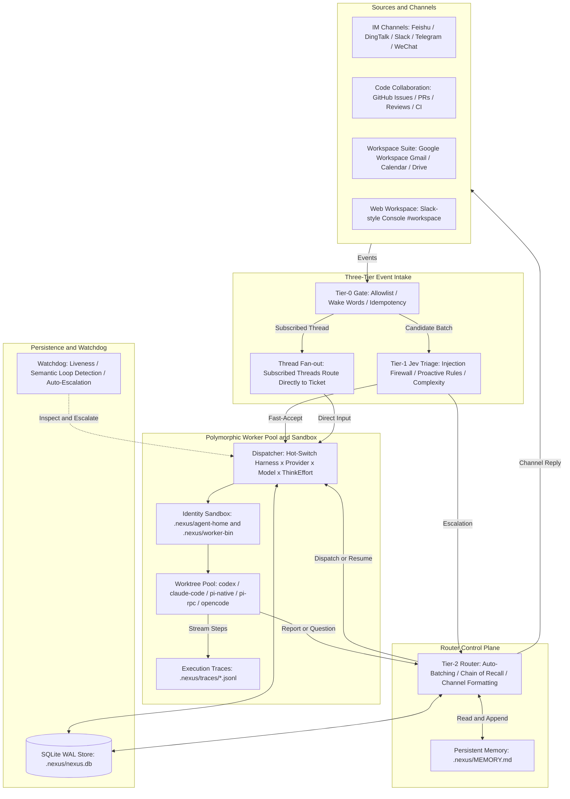

# Nexus

English | [简体中文](./README.zh-CN.md)

**An event-driven, dual-engine Super-Agent control plane and polymorphic worker runtime in Rust.**

Nexus unifies messaging channels (Feishu, DingTalk, Telegram, Slack, WeChat), code collaboration (GitHub Issues, PRs, Reviews, CI), and workspace suites (Google Workspace) into a single event stream. A resident dual-engine router coordinates isolated background workers across multiple coding harnesses (`codex`, `claude-code`, `pi-native`, `pi-rpc`, `opencode`), shifting human involvement from monitoring individual sessions to making decisions and reviewing deliverables.

---

## Core Design Principles

- **Minimize attention overhead**: Nexus stays quiet while workers progress in the background and surfaces notifications only when deliverables are ready (`Ready`), decisions are needed (`Blocked` / `Waiting`), or failures occur.
- **Cross-channel continuity**: Conversations across Feishu group topics, DingTalk chats, GitHub Issue/PR threads, and the Web workspace share persistent long-term memory (`.nexus/MEMORY.md`), while worker history injection (`src/workers/history.rs`) strictly isolates thread context by `(source, kind, conversation path)`.
- **Host vs. agent identity isolation**: Nexus runs workers inside an isolated credential sandbox (`.nexus/agent-home/` and `.nexus/worker-bin/`) with dedicated Git authorship (`.nexus/worker-gitconfig`) and scrubbed subprocess environments (`*_SECRET*`, `*_TOKEN*`, `*_KEY*`, `*_PASSWORD*`). An explicit `use_host_gh` option allows reusing host `gh` credentials when an agent account only has read access.
- **Strict worker workspace boundary**: Worker prompts prohibit probing or scanning host personal directories outside the assigned `git worktree` and `.nexus/MEMORY.md`, preventing macOS TCC / iCloud Drive popups and cross-repo leakage.
- **Tiered filtering and orchestration**: Deterministic admission rules (`Gate`) and a discriminative triage classifier (`Jev`) filter noise and prompt-injection payloads before escalating cross-task coordination to the generative `Router`.
- **Decoupled tickets and execution targets**: Each `Ticket` owns its worktree and history independently of any single session and can hot-switch `Harness x Provider x Model x ThinkEffort` mid-flight via `HandoffCard`.

---

## Architecture



### Key Mechanisms

1. **Three-Tier Routing & Context Locality**
   - **Tier-0 (`Gate`)**: Runs in sub-millisecond Rust code to enforce actor/bot allowlists, wake keywords, self-echo filtering, `(sourceId, externalId)` idempotency, inline target directives (`[harness:provider/model:think]`), and direct **Subscription Fan-out** for active tickets.
   - **Tier-1 (`Jev`)**: Discriminative classifier evaluating `injection_risk` (`>= 0.80` blocked), parallel proactive rules, route actions (`ignore`, `new_ticket`, `attach_ticket`, `stop_ticket`, `needs_llm_router`), `task_kind`, and `complexity`. Falls back to `HeuristicJevClassifier` when no remote Jev endpoint is configured.
   - **Feishu without a wake word**: DMs and replies in a subscribed ticket thread do not need a bot mention. In `auto` mode, remote Jev can start a new ticket for a clear task request like “Please add a regression test for login” from a user in `allowed_actors` in a group listed in `feishu.chat_ids`. Casual chat and messages that only @mention someone else do not trigger this path. The bot must be able to receive unmentioned group messages; the local fallback does not infer these task requests.
   - **Tier-2 (`Router`)**: Resident orchestrator using **Inline & Spill** budgeting plus **Chain of Recall** (`trigger/<id>`, `thread/<key>`, `ticket/<id>`, `ticket/<id>/report/<assignmentId>`, `decision/<id>`) and **Auto-Batching** across `off`, `observe`, and `auto` accept modes. See [docs/001-domain.md](docs/001-domain.md) and [docs/002-router-and-jev.md](docs/002-router-and-jev.md).

2. **Polymorphic Worker Pool & Priority Concurrency**
   - Every ticket operates in an isolated `git worktree` (`.nexus/worktrees/<short_name>`) on branch `agent/<short_name>`.
   - **GitHub issue delivery**: If a worker stops before delivery, Nexus resumes once on the same branch and worktree. It verifies that the current commit is in an open or merged PR before marking code changes ready. A specific question that needs a person ends the automatic continuation. If the daemon itself restarts mid-assignment, a human follow-up is required to resume. Shuttle status comments do not wake the ticket.
   - Priority-aware `WorkerSlots` (`max_concurrent_workers`, default `4`) reserves at least one slot for human wakeups when `N >= 2` so interactive follow-ups never queue behind background tasks.
   - Unified `WorkerHarnessDriver` supports `codex`, `claude-code`, `pi-native` (in-process ReAct loop with automatic `Planning -> Implementation` effort downgrade after the first file edit), `pi-rpc`, and `opencode`.
   - `GET /api/worker/models` merges installed catalogs from `pi --list-models`, `~/.pi/agent/{models.json,settings.json,models-store.json}`, `~/.codex/{config.toml,models_cache.json}`, `~/.claude/settings.json`, and `~/.config/opencode/opencode.json`. See [docs/003-worker-harnesses.md](docs/003-worker-harnesses.md).

3. **Identity Sandbox, Shims & Rich Channel Delivery**
   - `<state_dir>/worker-bin/` exposes `gh-agent` (plus `gh`), `lark-bot` (plus `lark-cli`), `gws-agent` (plus `gws`), `dws-agent` (plus `dws`), and `nexus-worker`, backed by `<state_dir>/worker-gitconfig` (`GIT_CONFIG_GLOBAL`).
   - Supports `AgentIdentityConfig.use_host_gh` when workers need host `gh` write access while retaining isolated commit identity or Feishu/DingTalk profiles.
   - Supports Markdown rich text and local/web image delivery through DingTalk (`dws-agent`) and Feishu (`lark-bot`). See [docs/004-persistence-and-shims.md](docs/004-persistence-and-shims.md) and [docs/005-adapters-matrix.md](docs/005-adapters-matrix.md).

4. **Dual-Mode Web Console (`127.0.0.1:3082`)**
   - Built with **React 19 + TypeScript + Vite + Tailwind CSS v4** (`web/`):
     - **Collaborative Workspace (`#workspace`, default)**: Slack-style channel view (`Inbox`, `General`, `Active`, per-repository `#repo` channels, per-source channels), status filters, inline engine/model/think picker (`POST /api/triggers`), and a slide-over Thread + Worker Trace Drawer.
     - **Control Plane Admin (`#admin`)**: Ticket dashboard with mid-flight hot-switching, live Worker Trace studio (`.nexus/traces/*.jsonl`), conversation stream, Dual-Engine Router & Jev tester, `MEMORY.md` editor, identity isolation matrix, and toolchain configuration.

---

## Quick Start

### Prerequisites

- **Build & Runtime**: Rust `1.85+` (Edition 2024), Node.js `20+` (for building `web/`), `git` `2.32+`
- **Optional Channel & Harness CLIs**: `gh`, `lark-cli`, `dws`, `gws`, `codex`, `claude`, `pi`, `opencode`

### Build

```bash
git clone https://github.com/xdlkc/nexus.git
cd nexus

# 1. Build the Web console bundle (outputs to web/dist)
cd web && npm install && npm run build && cd ..

# 2. Build the Rust daemon and CLI
cargo build --release
```

### Setup & Run

```bash
# Probe local tools, provision .nexus/worker-bin shims, and write .nexus/config.json
./target/release/nexus setup --state-dir .nexus

# Authenticate an isolated GitHub CLI identity (separate from ~/.config/gh)
GH_CONFIG_DIR="$PWD/.nexus/agent-home/gh" gh auth login -h github.com -p https -w

# Start the daemon and HTTP/Web console on http://127.0.0.1:3082
./target/release/nexus start --state-dir .nexus
```

Useful CLI subcommands:

- `nexus start --state-dir .nexus --once`: Run a single deterministic poll + effect-drain cycle and exit with JSON summary.
- `nexus status --api-url http://127.0.0.1:3082`: Query live state from a running daemon.
- `nexus worker report|read|handback|switch-target`: Callback commands used by worker harnesses via `nexus-worker`.

---

## Testing

```bash
# Run all unit, integration, and end-to-end simulation tests
cargo test

# Verify frontend TypeScript types and production bundle
cd web && npm run build
```

---

## Documentation

- [001 — Domain Model & State Contracts](docs/001-domain.md)
- [002 — Dual-Engine Router & Context Cache](docs/002-router-and-jev.md)
- [003 — Polymorphic Worker Pool & Harnesses](docs/003-worker-harnesses.md)
- [004 — Persistence, Credential Shims & Watchdog](docs/004-persistence-and-shims.md)
- [005 — Peripheral Adapters Matrix](docs/005-adapters-matrix.md)

---

## License

MIT (as declared in [Cargo.toml](Cargo.toml))
