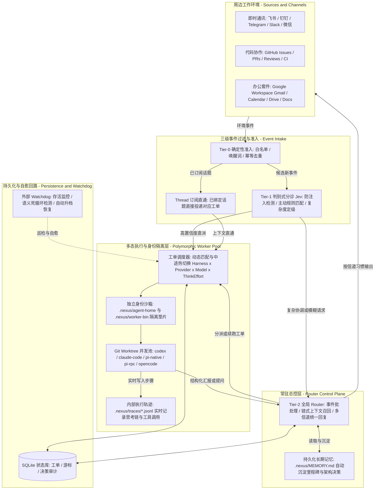

# Nexus

**事件驱动、双核路由的自主 Super-Agent 系统底座（Control Plane & Multi-Harness Runtime）**

Nexus 是一个持续在线、跨渠道协同的 Super-Agent 运行时系统。它将即时通讯（飞书、钉钉、Telegram、Slack、微信）、代码托管平台（GitHub 多仓库 Issues / PRs / Reviews / CI）与办公套件（Google Workspace）接入统一的事件流，在后台通过**独立隔离的 Agent 身份与工作空间**并发调度多种 Coding Harness（`codex`、`claude-code`、`pi-native`、`pi-rpc`、`opencode`）完成研发与日常任务，让人的角色从繁琐的“单会话盯梢与上下文搬运”上移到更高层的 **“决策与验收”**。

---

## 核心思想

主流 Agent 工具默认将“任务”绑定在彼此隔离的单次对话窗口（`Session`）中：单任务的上限取决于模型能力，而多任务并发的上限却受制于人的注意力。Nexus 旨在打破这一限制，将 `Session` 退化为系统底层的实现细节：

- **最小化注意力消耗**：系统的每一条通知、每一次提问都在消耗人的注意力。Nexus 仅在结果就绪（`Ready`）、需要关键决策（`Blocked`）或任务异常时主动发声，其余时间在后台静默推进。
- **跨信道全局连续**：无论你在飞书群里讨论方案、在 GitHub Issue/PR 下提需求或做 Code Review，面对的始终是同一个拥有全局连续记忆（`.nexus/MEMORY.md`）的 Agent（奈克斯）。
- **宿主机与 Agent 身份完全隔离**：Nexus 拥有独立的凭证沙箱（`.nexus/agent-home/`）与 CLI 垫片层（`.nexus/worker-bin/`），其 Git 提交身份、GitHub 账号（如 `@lkc12138-cloud`）、飞书 Profile 与宿主机开发者的个人账号彻底解耦。
- **确定性守门 + 判别式分诊 + 生成式编排**：融合经典计算机系统的分层思想，用确定性规则与轻量判别模型（Tier-1 `Jev`）过滤环境噪音，只把跨任务协调交给生成式大模型（Tier-2 `Router`）。
- **工单与执行器解耦**：工作单元（`Ticket`）与具体执行器分离，支持按任务特性自由组合并在运行中途热切换底层的 **`Harness × Provider × Model × Think Effort`**。

---

## 系统架构

Nexus 采用 **双层解耦架构（常驻 Router 控制面 + 隔离 Worker 执行面）**，配合事件总线、SQLite 持久化状态存储、全链路轨迹追踪与外部自愈回路运行：



### 关键机制

1. **三级事件过滤与双核路由（Dual-Engine Router）**
   - **Tier-0（确定性快路径）**：通过身份白名单、群唤醒词（如 `奈克斯` / `nexus`）与自身回声过滤（忽略 Bot 自身创建的 Issue/PR 防止自激循环）毫秒级滤除无关噪音；对已绑定工单的话题（`Thread`）直接旁路直通对应 Worker。
   - **Tier-1（判别式分诊器 `Jev`）**：支持本地零延迟启发式规则与远端 TypeSafe / OpenRouter / OpenAI 协议，对候选事件做防注入检测、任务分类与复杂度定级。
   - **Tier-2（生成式 `Router`）**：负责跨任务协调、按需多跳召回历史上下文（**Inline & Spill + 链式召回**），并在事件密集涌入时自动合并批处理（**Auto-Batching**）。

2. **多态 Worker 引擎与级联模型目录**
   - 每个工单在独立的 Git Worktree（`.nexus/worktrees/work-<id>`）中并发运行。
   - 自动探测宿主机与 Agent 生态的 5 大 Harness 真实配置目录：
     - `codex`：自动读取 `~/.codex/config.toml` 与 `~/.codex/models_cache.json`
     - `claude-code`：自动读取 `~/.claude/settings.json` 与 `modelPicker`
     - `pi-native` / `pi-rpc`：自动合并 `~/.pi/agent/models.json`（支持自定义 `hub`、`kimi-coding` 等 Provider）、`~/.pi/agent/settings.json`、`models-store.json` 与 `pi --list-models`
     - `opencode`：自动读取 `~/.config/opencode/opencode.json` 与 `opencode models`

3. **独立身份沙箱（Isolated Agent Identity）**
   - `.nexus/agent-home/gh`：存放 Nexus 专属 GitHub CLI 登录态（`GH_CONFIG_DIR` 隔离），与宿主机本机 `~/.config/gh` 完全分离。
   - `.nexus/worker-gitconfig`：强制注入 Worker 的独立 `user.name` 与 `user.email`，并自动将 `https://github.com/` 的 Git push/fetch 凭证代理至隔离的 `gh-agent auth git-credential`。
   - `.nexus/worker-bin/`：自动为 Worker 注入 `gh`、`lark-cli`、`gws`、`dws` 隔离垫片并净化敏感环境变量。

4. **全链路可观测性与 React + TypeScript 控制台**
   - 内置基于 **React 19 + TypeScript + Vite + Tailwind CSS v4** 构建的现代化 Web 控制台（默认监听 `http://127.0.0.1:3082`）：
     - **活跃工单与热切换**：支持按仓库筛选工单、一键打开 GitHub PR、运行中热切换 `Harness × Provider × Model × Think Effort`（带实时关键字搜索过滤下拉框）。
     - **Worker 内部轨迹分析器**：实时流式展示每个工单内部的启动 Prompt、思考推理链（`💭 Thinking`）、Shell 命令调用（`🔧 Tool Call`）、标准输出（`📤 Stdout`）与 Token 消耗。
     - **独立身份对比矩阵**：直观对比宿主机账号与奈克斯独立账号的隔离状态。
     - **长期记忆管理（`MEMORY.md`）**：工单完成交付或敲定架构决策时自动去重归档至 `.nexus/MEMORY.md`，并支持在线编辑。

---

## 安装与快速上手

### 环境要求
- **编译与运行时**：Rust 1.85+（Edition 2024）、Node.js 20+（用于构建 `web/` 前端工程）、`git` 2.32+
- **按需安装的外部 CLI**：
  - GitHub 协作：`gh` (GitHub CLI)
  - 飞书接入：`lark-cli`
  - 钉钉 / Google Workspace（可选）：`dws`、`gws`
  - 外部 Worker Harness（可选）：`codex`、`claude`、`pi`、`opencode`

### 编译构建

```bash
git clone https://github.com/xdlkc/nexus.git
cd nexus

# 1. 构建 TypeScript 前端控制台 (输出至 web/dist)
cd web && npm install && npm run build && cd ..

# 2. 编译 Rust 核心二进制
cargo build --release
```

### 启动与管理

```bash
# 初始化 .nexus 状态目录与独立身份隔离沙箱
./target/release/nexus setup --state-dir .nexus

# 为奈克斯登录独立的 GitHub 账号（与本机 gh 完全隔离）
GH_CONFIG_DIR="$PWD/.nexus/agent-home/gh" gh auth login -h github.com -p https -w

# 启动常驻守护服务（同时挂载 HTTP/Web 控制台 127.0.0.1:3082）
./target/release/nexus start --state-dir .nexus
```

服务启动后，浏览器打开 `http://127.0.0.1:3082` 即可进入 **Nexus Super-Agent Control Plane**。

---

## 开发与测试

```bash
# 运行全部单元、集成与端到端仿真测试
cargo test

# 前端类型检查与生产构建
cd web && npm run build
```

---

## 许可证

MIT
