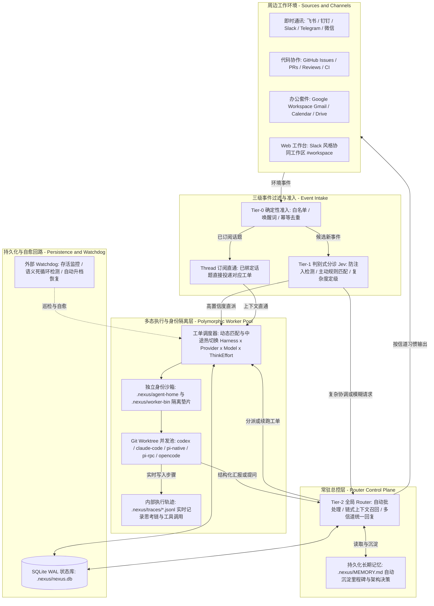

# Nexus

[English](./README.md) | 简体中文

**事件驱动、双核路由的自主 Super-Agent 系统底座（Control Plane & Multi-Harness Runtime）。**

Nexus 将即时通讯（飞书、钉钉、Telegram、Slack、微信）、代码托管平台（GitHub 多仓库 Issues / PRs / Reviews / CI）与办公套件（Google Workspace）接入统一的事件流，在后台通过**独立隔离的 Agent 身份与工作空间**并发调度多种 Coding Harness（`codex`、`claude-code`、`pi-native`、`pi-rpc`、`opencode`）完成研发与日常任务，让人的角色从繁琐的“单会话盯梢与上下文搬运”上移到更高层的 **“决策与验收”**。

---

## 核心思想

- **最小化注意力消耗**：Nexus 仅在结果就绪（`Ready`）、需要关键决策（`Blocked` / `Waiting`）或任务异常时主动发声，其余时间在后台静默推进。
- **跨信道全局连续与会话隔离**：无论在飞书话题、钉钉群聊、GitHub Issue/PR 还是 Web 工作台协同，系统都维护统一的长期记忆（`.nexus/MEMORY.md`）；同时，Worker 历史注入层（`src/workers/history.rs`）严格按 `(source, kind, conversation path)` 隔离不同会话线程的历史上下文，避免跨话题串扰。
- **宿主机与 Agent 身份完全隔离**：Nexus 拥有独立凭证沙箱（`.nexus/agent-home/`）与 CLI 垫片层（`.nexus/worker-bin/`），配合 `.nexus/worker-gitconfig` 将 Git 提交身份与 `gh` / `lark-cli` / `gws` / `dws` 账号彻底解耦，并从子进程环境清洗敏感凭证（`*_SECRET*`、`*_TOKEN*`、`*_KEY*`、`*_PASSWORD*`）。若独立 Agent 账号对目标仓库仅有只读权限，可通过 `AgentIdentityConfig.use_host_gh` 显式复用宿主机 `gh` 登录态。
- **严格的 Worker 工作区边界**：Worker 提示词严格限制所有文件读写、检索与 Shell 命令仅在分配的 `git worktree` 与 `.nexus/MEMORY.md` 内执行，禁止扫描宿主机个人目录（`~`、`$HOME`、`~/Documents`、`~/Library` 等），防止触发 macOS TCC / iCloud 隐私弹窗；遇到未定义工具或需求歧义时通过 `nexus worker report --status waiting` 询问用户。
- **确定性守门 + 判别式分诊 + 生成式编排**：用确定性规则（`Gate`）与轻量判别模型（Tier-1 `Jev`）过滤噪音和提示词注入，只把跨任务协调交给生成式总控（Tier-2 `Router`）。
- **工单与执行器解耦**：工作单元（`Ticket`）持有独立的工作区与输入历史，支持在运行中途热切换 **`Harness × Provider × Model × ThinkEffort`**。

---

## 系统架构



### 关键机制

1. **三级事件过滤与双核路由（Dual-Engine Router）**
   - **Tier-0（确定性快路径 `Gate`）**：毫秒级校验白名单、唤醒词、Bot 自回声过滤、`(sourceId, externalId)` 幂等去重与行内指令（`[harness:provider/model:think]`）；对已绑定工单的话题通过 **Subscription Fan-out** 直通对应 Worker。
   - **Tier-1（判别式分诊器 `Jev`）**：支持本地启发式 `HeuristicJevClassifier` 与远端 `HttpJevClient`，执行提示词注入防火墙（`injection_risk >= 0.80` 拦截）、主动规则并发评估、路由动作判定与 `(task_kind, complexity)` 定级。
   - **飞书免唤醒词**：私聊和已绑定工单的话题回复无需 @ 机器人。在 `auto` 模式下，`allowed_actors` 白名单里的用户在 `feishu.chat_ids` 配置的群聊中说“帮我给登录模块补一个回归测试”，远端 Jev 可以识别这种明确请求并新建工单。普通闲聊、只 @ 其他人的消息不会走这条路径。机器人须能收到未 @ 的群消息；本地回退不会推断这类任务请求。
   - **Tier-2（生成式 `Router`）**：负责跨任务协调、**Inline & Spill + 链式召回**（`trigger/<id>`、`thread/<key>`、`ticket/<id>`、`ticket/<id>/report/<assignmentId>`、`decision/<id>`）以及事件密集时的 **Auto-Batching**（支持 `off | observe | auto` 接单模式）。详见 [docs/001-domain.md](docs/001-domain.md) 与 [docs/002-router-and-jev.md](docs/002-router-and-jev.md)。

2. **多态 Worker 引擎、优先级槽位与级联模型目录**
   - 每个工单在独立的 Git Worktree（`.nexus/worktrees/<short_name>`，分支 `agent/<short_name>`）中运行，通过 `HandoffCard` 在热切换 Harness 时无缝交接上下文与工作区 Diff。
   - **GitHub Issue 交付**：Worker 未交付就停下时，奈克斯会用原分支和工作区自动接续一次。代码改动须确认当前提交已进入开放或已合并的 PR，才标记为待审；需要人工回答具体问题时不自动接续。守护进程本身在执行中重启时，须由人工跟进恢复。Shuttle 的状态回执不会唤醒工单。
   - `WorkerSlots`（默认 `max_concurrent_workers = 4`）在 `N >= 2` 时为人类唤醒消息保留专用槽位，避免人工跟进被后台任务饿死。
   - 统一 `WorkerHarnessDriver` 覆盖 `codex`、`claude-code`、`pi-native`（内置 ReAct 循环，首次文件编辑后自动从 `Planning` 降档至 `Implementation` 推理强度）、`pi-rpc` 与 `opencode`。
   - `GET /api/worker/models` 自动聚合 `pi --list-models`、`~/.pi/agent/{models.json,settings.json,models-store.json}`、`~/.codex/{config.toml,models_cache.json}`、`~/.claude/settings.json` 与 `~/.config/opencode/opencode.json`。详见 [docs/003-worker-harnesses.md](docs/003-worker-harnesses.md)。

3. **独立身份沙箱、垫片层与富媒体投递**
   - `<state_dir>/worker-bin/` 自动生成 `gh-agent`（及 `gh`）、`lark-bot`（及 `lark-cli`）、`gws-agent`（及 `gws`）、`dws-agent`（及 `dws`）与 `nexus-worker` 垫片，配合 `<state_dir>/worker-gitconfig`（`GIT_CONFIG_GLOBAL`）完成身份隔离。
   - 飞书（`lark-bot`）与钉钉（`dws-agent`）支持 Markdown 富文本与本地/网络图片投递。详见 [docs/004-persistence-and-shims.md](docs/004-persistence-and-shims.md) 与 [docs/005-adapters-matrix.md](docs/005-adapters-matrix.md)。

4. **双模式 Web 控制台（`127.0.0.1:3082`）**
   - 基于 **React 19 + TypeScript + Vite + Tailwind CSS v4**（`web/`）构建：
     - **协同工作台（`#workspace`，默认入口）**：Slack 风格多频道协同界面，包含左侧频道栏（收件箱、通用频道、活跃工单、按仓库 `#repo` 频道、按来源通道筛选）、状态过滤、内联 `Harness / Model / Think` 调度输入框（通过 `POST /api/triggers` 投递）与右侧滑出式话题详情 + Worker 执行轨迹抽屉。
     - **控制面后台（`#admin`）**：活跃工单与运行中热切换（`Harness × Provider × Model × ThinkEffort`）、Worker 内部轨迹分析器（`.nexus/traces/*.jsonl`）、群聊上下文与回复流、双引擎路由与 `Jev` 实时测试器、`MEMORY.md` 在线编辑器、独立身份对比矩阵及工具链配置。

---

## 快速开始

### 环境要求

- **编译与运行时**：Rust `1.85+`（Edition 2024）、Node.js `20+`（用于构建 `web/` 前端）、`git` `2.32+`
- **按需安装的外部 CLI**：`gh`、`lark-cli`、`dws`、`gws`、`codex`、`claude`、`pi`、`opencode`

### 编译构建

```bash
git clone https://github.com/xdlkc/nexus.git
cd nexus

# 1. 构建 TypeScript 前端控制台（输出至 web/dist）
cd web && npm install && npm run build && cd ..

# 2. 编译 Rust 核心二进制
cargo build --release
```

### 初始化与启动

```bash
# 探测本机工具链、生成 .nexus/worker-bin 垫片并写入 .nexus/config.json
./target/release/nexus setup --state-dir .nexus

# 为 Nexus 登录独立的 GitHub 账号（与宿主机 ~/.config/gh 完全隔离）
GH_CONFIG_DIR="$PWD/.nexus/agent-home/gh" gh auth login -h github.com -p https -w

# 启动常驻守护服务与 Web 控制台（默认监听 http://127.0.0.1:3082）
./target/release/nexus start --state-dir .nexus
```

常用 CLI 子命令：

- `nexus start --state-dir .nexus --once`：执行单次确定性轮询与副作用排空循环后退出并输出 JSON 摘要。
- `nexus status --api-url http://127.0.0.1:3082`：查询运行中守护进程的实时状态。
- `nexus worker report|read|handback|switch-target`：供 Worker Harness 通过 `nexus-worker` 回调控制面。

---

## 开发与测试

```bash
# 运行全部单元、集成与端到端仿真测试
cargo test

# 前端类型检查与生产构建
cd web && npm run build
```

---

## 设计文档

- [001 — 领域模型与状态契约](docs/001-domain.md)
- [002 — 双核路由与上下文缓存](docs/002-router-and-jev.md)
- [003 — 多态 Worker 池与 Harness 驱动](docs/003-worker-harnesses.md)
- [004 — 持久化存储、凭证垫片与 Watchdog](docs/004-persistence-and-shims.md)
- [005 — 外设适配器矩阵](docs/005-adapters-matrix.md)

---

## 许可证

MIT（见 [Cargo.toml](Cargo.toml) 声明）
