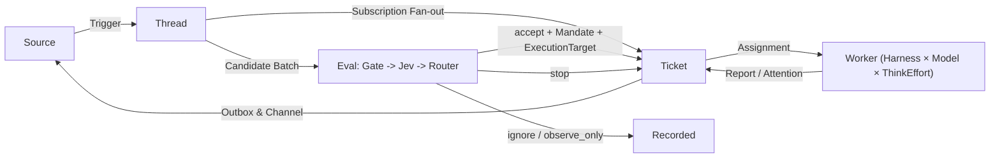

# 001 领域模型与状态契约 (Domain Model)

本文档定义 `Nexus` 的核心领域概念、状态流转规则与系统不变量。代码实现、工具 Schema、持久化表结构与控制面板均严格使用本文档定义的术语。

---

## 1. 核心数据流

环境事件从外部源（`Source`）进入系统，转化为不可变的触发记录（`Trigger`）并归入有序话题（`Thread`）：
1. 若 `Trigger` 命中已订阅该 `Thread` 的活跃或可唤醒工单（`Ticket`），则通过 **订阅扇出（Subscription Fan-out）** 直接作为上下文输入（`Input`）投递给对应的执行实例（`Assignment`），绕过中心路由评估。
2. 其余 `Trigger` 进入 **评估流水线（`Eval`）**：依次经过确定性准入（`Gate`）、System-1 判别模型（`Jev Triage`）与可选的 System-2 常驻路由会话（`Router Session`），最终产出裁决（`Decision`）。
3. 当裁决为接单（`accept`）时，系统原子化创建 `Ticket`、授权凭证（`Mandate`）、默认订阅关系（`Subscription`）以及首个绑定了具体 `ExecutionTarget`（`Harness × Model × ThinkEffort`）的 `Assignment`。
4. Worker 的产出与提问通过 `Channel` 经由事务收件箱（`Outbox`）投递回对应的外部平台。

---

## 2. 领域概念表

| 概念 (Term) | 中文名 | 定义与职责 | 核心不变量 (Invariants) |
| :--- | :--- | :--- | :--- |
| **`Source`** | 事件源 | 外部事件流的一个配置实例（如某个飞书群/机器人、某个 GitHub 仓库、某个 Gmail 邮箱） | 独立维护读取游标（Cursor）与自身 Bot 身份；自动丢弃自身发出的消息以防回环；重启后绝不重放已处理的事件。 |
| **`Trigger`** | 触发事件 | 来自 `Source` 的单条不可变原始事件（含发送者标识、时间戳、文本/图片载荷及源元数据） | 全局幂等键为 `(sourceId, externalId)`；同一 `Trigger` 被重复接收不会产生第二个 `Ticket`。 |
| **`Thread`** | 话题线程 | 按时间排序的关联 `Trigger` 序列（如同一个 GitHub Issue/PR、同一个飞书/Slack 话题串、同一封 Gmail 邮件串） | 同一时刻一个 `Thread` 上最多运行一个 `Eval`；在 `Eval` 运行期间新到达的 `Trigger` 自动积压并合并入下一批次。 |
| **`Channel`** | 投递信道 | `Thread` 的写入侧地址描述（决定回复发往哪个群话题、PR 评论区或邮件草稿箱） | 所有对外消息必须附带幂等收据 ID 并经由 `Outbox` 顺序发出；遵循对应信道的字数与格式规范。 |
| **`Policy`** | 策略配置 | 带版本号的全局与源级准入规则（白名单、准入表、接单模式 `off\|observe\|auto` 及主动规则列表） | 每次修改生成新的 `policyVersion`；策略变更会中止正在运行的旧版 `Eval` 并重新入队，但不会强行杀死已在运行的 `Ticket`。 |
| **`Eval`** | 评估过程 | 将一批候选 `Trigger` 转化为 `Decision` 的无状态判断过程（含 `Gate`、`Jev` 与 `Router` 三阶段） | 不持久持有可变状态；超时未完成的 `Eval` 自动重试，连续失败三次标记为 `unavailable` 并触发告警。 |
| **`Decision`** | 路由裁决 | `Eval` 的输出结论：`accept`（接单）、`attach`（并入已有工单）、`stop`（停止工单）、`ignore`（忽略/仅观察记录） | 每条 `Decision` 必须记录结构化原因码（`ReasonCode`）及触发该裁决的 `Trigger` ID。 |
| **`Mandate`** | 授权凭证 | `accept` 时颁发的不可变授权记录（记录当时的 `policyVersion`、授权强度 `explicit\|inferred`、发起人及匹配的主动规则） | 已完结的 `Ticket` 被人类新消息唤醒前，必须针对当前最新 `Policy` 重新校验（Revalidate）其 `Mandate` 是否依然有效。 |
| **`Ticket`** | 工单 | 经过授权的独立工作单元（持有专属工作目录、`Mandate`、`Channels`、`Subscriptions` 及 `Inputs` 历史） | 生命周期独立于底层任何单一 Agent Session；可跨越多次 `Assignment`（由不同 Harness 接力完成）。 |
| **`ExecutionTarget`** | 执行目标 | 驱动 Worker 运行的三元组配置：`(harness, provider/model, thinkEffort)` | 可在建单时由 `Jev` 或 `Router` 自动选定，也可由人类在对话中通过行内标签或自然语言动态覆盖。 |
| **`Assignment`** | 派工实例 | 将一个 `Ticket` 绑定到一个具体 `ExecutionTarget` 的单次执行尝试 | 一个 `Ticket` 按时间顺序可拥有多个 `Assignment`（但同一时刻最多一个处于 `running`）；切换 Harness 或重试时关闭旧 `Assignment` 并开启新实例。 |
| **`Subscription`** | 订阅关系 | `Ticket` 与 `Thread` 之间的多对多（M:N）关联，分为**主订阅（Own/Active）**与**仅上下文订阅（Context-only）** | 主订阅下的新人类消息直接归属该 `Ticket` 处理并可唤醒已完结工单；仅上下文订阅（如关联参考 Issue）只投递消息而不赋予唤醒或变更权限。 |

---

## 3. 工单状态机 (`TicketStage`)

每个处于打开状态（`open`）的 `Ticket` 在任意时刻处于以下唯一阶段（按优先级从高到低匹配，前四项均表示**等待人工介入**，会出现在注意力面板顶部）：

| 阶段标识 (`TicketStage`) | 触发条件 | 含义与恢复方式 |
| :--- | :--- | :--- |
| **`person/delivery`** | 向 Worker 会话投递 `Input` 连续失败 | 投递通道异常；系统按指数退避重试，或由人工点击 Retry 启动新 `Assignment` |
| **`person/answer`** | 最新 `Report` 附带未回答的结构化提问（`Attention`） | 等待人类在原聊天话题或面板中回答问题 |
| **`person/review`** | 最新 `Report` 状态为 `ready` 且存在关联的打开 PR 或草稿 | 交付物已就绪，等待人类 Code Review、合并 PR 或确认发送草稿 |
| **`person/blocked_failed`** | 最新 `Report` 为 `blocked` 或 `failed`，且此后尚无新的人类消息到达 | 任务受阻或执行失败；停止接收自动 CI/Bot 消息，等待人类发送新指令或切换 `ExecutionTarget` 重试 |
| **`working/queued`** | 尚未分配 `Assignment`，或正等待空闲 Worker 并发槽位 | 排队等待执行槽位释放（人类跟进消息唤醒享有高优专用槽位） |
| **`idle`** | 最新 `Report` 为 `waiting`，且后台无运行中的命令或子任务 | 当前轮次工作完毕，静默监听所订阅 `Thread` 的后续事件（如 CI 结果或 Review 评论） |
| **`working`** | `Assignment` 正在推理，或后台仍有 Shell 任务 / 子 Agent 运行 | 正在后台推进工作 |

---

## 4. 派工与跨 Harness 交接规则 (`Assignment` & `Handoff`)

1. **目录与环境持久化**：每个 `Ticket` 对应唯一的工作目录（如基于目标仓库检出的独立 `git worktree`）。`Assignment` 的更替不会销毁该目录。
2. **无缝热切换（Handoff）**：当由于用户指令、Router 调度或 Watchdog 自动升档而改变 `Ticket` 的 `ExecutionTarget`（例如从 `pi-native + sonnet + medium` 切换至 `codex + gpt-5.6-sol + xhigh`）时：
   - 当前正在运行的 `Assignment` 被平滑终止（回收后台进程与槽位）。
   - 系统创建新的 `Assignment`，绑定新的 `ExecutionTarget` 并在同一工作目录下启动。
   - 系统自动生成 **交接卡片（`HandoffCard`）** 作为新 `Assignment` 的首条上下文，内联：原始任务需求、前序 `Assignment` 的最后汇报摘要、当前工作区 `git status / diff --stat` 概览，以及所有尚未处理完毕的 `Input`。
3. **完成与关闭判定**：
   - 若工单未绑定任何外部 PR：当 Worker 汇报 `ready`（无需后续外部关闭事件）或 `dropped`（确认无需处理，如问题无法复现）时，工单完结。
   - 若工单创建或绑定了 GitHub PR：仅当其创建的所有 PR 均已合并（`merged`）或关闭（`closed`），且无未读的人类跟进消息时，工单才正式完结；完结后仍保留 `Thread` 订阅，若人类后续在同一 PR 或话题下继续评论，工单将在校验 `Mandate` 后自动原地唤醒。
